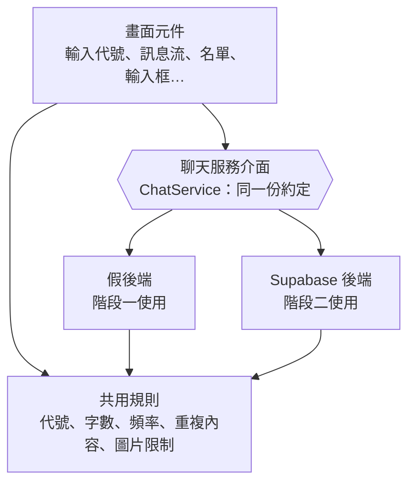
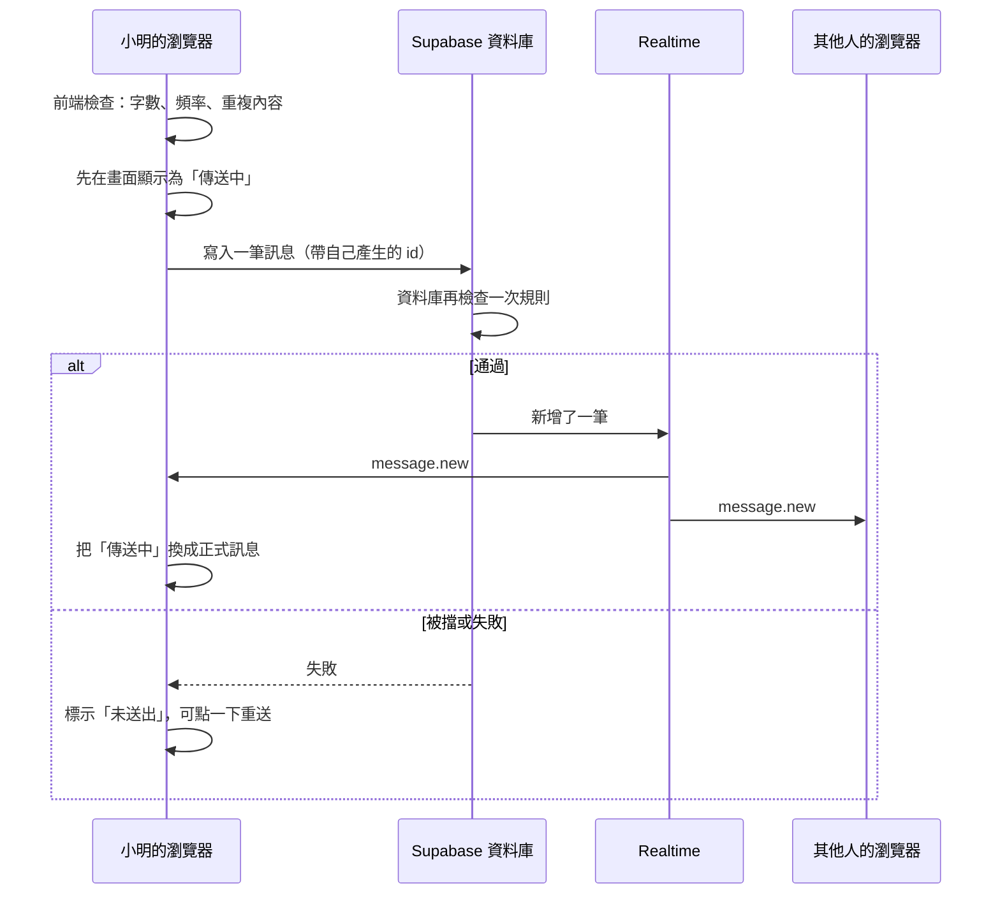

# phoon-chat 架構文件

> 這份文件寫給「不寫程式、但要決定產品長什麼樣子」的人看。
> 專有名詞第一次出現時，會用一句話解釋。
> 需求來源：[`docs/requirements.md`](./requirements.md)，以及需求訪談中確認的細節（整理在各段落裡）。
> 這份文件只規劃，不包含任何程式碼；畫面的顏色與樣式由 `/design` 負責，前端實作由 `/frontend-design` 負責。

---

## 1. 專案說明與目標

**phoon-chat 是一個不用註冊、不用登入的匿名聊天室。** 所有人都在同一個聊天室裡，任何拿到網站連結的人，用電腦或手機打開就能用。

使用者的流程：

1. 打開網頁。
2. 輸入一個代號（暱稱）。
3. 進入聊天室，看到最近的訊息和誰在線上，也可以送出文字或圖片。
4. 想離開時按「離開」，或直接關掉網頁。

**目標**

- 零門檻：不需要帳號，輸入代號就能聊。
- 即時：別人送出訊息、進來、離開，幾乎立刻看到。
- 手機和電腦都好用。
- 全部用免費服務就能跑起來。
- 分兩階段做：先把畫面做好、放上網路看得到，最後才接上真正的即時傳訊服務。

**使用者會看到的功能（訪談確認）**

| 項目 | 決定 |
|---|---|
| 代號 | 不能和目前在線上的人重複，大小寫視為相同；1 到 12 個字；中文、英文、數字、emoji 都可以；前後空白自動去掉；「系統」「管理員」「admin」這類容易冒充官方的字不能用 |
| 再回來時 | 重新整理或隔天再開，輸入框會自動填入上次的代號，使用者按一下才進入 |
| 歷史訊息 | 進來先看到最近約 50 則，往上滑到頂可以繼續載入更早的訊息 |
| 保留時間 | 訊息和圖片保留 30 天，更早的自動消失 |
| 訊息內容 | 純文字、網址自動變成可點的連結、圖片（只限 JPG、PNG、GIF、WebP，單張 5 MB 以內） |
| 傳圖片的方式 | 按鈕選檔、貼上截圖、拖曳進聊天室，三種都支援 |
| 防洗版 | 單則文字最多 500 字；每秒最多送 1 則；單則內同一個詞重複超過 10 次不能送；30 秒內連續送出相同內容，最多 5 則，第 6 則起不能送 |
| 刪除 | 使用者可以刪除自己送出的訊息，刪掉後所有人的畫面都會消失 |
| 在線名單 | 顯示人數和每個人的代號；手機上名單預設收起來，只露出人數 |
| 進出提示 | 在訊息流裡插入一行灰色小字，例如「小明 加入了聊天室」；這些提示不算歷史，新來的人往上翻不會看到別人以前的進出 |
| 訊息排版 | 全部靠左（像 Discord），自己的訊息用不同背景色；每則上方顯示代號和時間；同一人連續的訊息合併，只在第一則顯示代號 |
| 新訊息提示 | 正在往上翻舊訊息時，新訊息不會把畫面拉走，改顯示「有 N 則新訊息 ↓」，點一下才回到底部 |
| 離開 | 有「離開」按鈕，按下去立刻離開，其他人馬上看到提示；不做「換代號」功能（要換就離開再重新進入） |
| 斷線 | 顯示「重新連線中…」，恢復後自動補上錯過的訊息；沒送出的訊息標示「未送出」，可以點一下重送；短暫斷線不算離開 |
| 背景分頁 | 切去別的分頁時，分頁標題顯示未讀數，例如「(3) phoon-chat」；提示音預設關閉，使用者自己決定要不要開 |
| 外觀 | 深色、淺色模式都有，預設跟著系統設定，也可以手動切換；介面只有繁體中文 |

---

## 2. 整體架構圖

先用白話講一遍：

- **瀏覽器**（使用者手機或電腦上的 Chrome、Safari 等）是聊天室真正「執行」的地方。
- **GitHub Pages**（GitHub 提供的免費網頁空間）只負責把網頁檔案交給瀏覽器，它不會處理任何聊天訊息。
- **Supabase**（一個免費額度夠用的雲端後端服務，等於替我們準備好資料庫、即時傳訊、檔案儲存）負責所有「大家共用」的東西：訊息、誰在線上、圖片。

```mermaid
flowchart LR
  subgraph U["使用者的手機或電腦"]
    B["瀏覽器<br/>執行聊天室網頁"]
  end

  subgraph GH["GitHub"]
    R["repo<br/>原始程式碼"]
    A["GitHub Actions<br/>自動打包"]
    P["GitHub Pages<br/>存放網頁檔案"]
  end

  subgraph SB["Supabase（階段二才接上）"]
    AU["匿名登入<br/>替每個瀏覽器發一個隱形身分"]
    RT["Realtime 即時服務<br/>Presence、Broadcast、資料庫變更通知"]
    DB[("Postgres 資料庫<br/>messages 資料表")]
    ST["Storage<br/>chat-images 圖片櫃"]
    EF["Edge Function 排程<br/>每天清理 30 天前的資料"]
  end

  R -->|"推送程式碼"| A
  A -->|"打包後發布"| P
  P -->|"下載網頁檔案"| B
  B <-->|"WebSocket 長連線"| RT
  B -->|"取得身分"| AU
  B -->|"寫入、讀取歷史訊息"| DB
  B -->|"上傳、顯示圖片"| ST
  DB -->|"新增、刪除時通知"| RT
  EF -->|"刪除過期訊息"| DB
  EF -->|"刪除過期圖片"| ST
```



**階段一（還沒接 Supabase）時**，圖裡整個 Supabase 區塊是不存在的，瀏覽器裡由一個「假的後端」代替（見第 4 段）。

---

## 3. 技術選擇

每一項都寫「選了什麼」和「為什麼」。

### 3.1 前端：Vite + React + TypeScript

| 名詞 | 一句話解釋 |
|---|---|
| 前端 | 使用者在瀏覽器裡看到和操作的那一半程式 |
| 框架 | 別人整理好的程式骨架，讓我們不用從零蓋起 |
| React | 目前最多人使用的前端框架，擅長「資料一變、畫面自動跟著變」，很適合聊天室這種不停有新訊息的畫面 |
| TypeScript | 在 JavaScript（網頁的標準語言）上加上「資料長什麼樣子」的標註，寫錯格式時能提早被抓到 |
| Vite | 負責在開發時預覽、完成後把程式打包成可以放到網路上的檔案的工具 |

**為什麼這樣選**

- **React**：資料與說明文件最多，`/frontend-design` 產出的元件通常也是 React，對接最順；聊天室的訊息流、名單、輸入框都是「資料變了畫面就要更新」的典型場景。
- **TypeScript**：聊天室有很多固定格式的資料（訊息、在線成員、事件）。有了格式標註，階段一的假後端和階段二的 Supabase 後端必須吐出一模一樣的資料，換後端時不會悄悄出錯。這是「不用整個重寫」的重要保險。
- **Vite**：設定最少、打包結果就是純靜態檔案，正好符合 GitHub Pages「只能放靜態檔案」的限制。
- **不選 Next.js 之類的伺服器框架**：GitHub Pages 無法執行伺服器程式，用不到。
- **不選純 HTML 手寫**：聊天室狀態（連線中、未送出、新訊息提示、名單展開）很多，手寫會很快變得難以維護。
- **不另外裝大型狀態管理或 UI 套件**：這個專案規模小，React 內建的功能就夠，少一個套件就少一個要維護的東西。樣式用一般 CSS 搭配「CSS 變數」（一組可以整批切換的顏色設定），深淺色模式就是切換這組變數。

### 3.2 後端：Supabase 的哪些功能

| Supabase 功能 | 一句話解釋 | 這個專案拿來做什麼 | 為什麼選它 |
|---|---|---|---|
| **Realtime（即時服務）** | 讓瀏覽器和伺服器保持一條 **WebSocket**（一條不斷線、雙方隨時能傳資料的連線）的功能 | 即時推送新訊息、刪除訊息、進出事件 | 你指定要用 WebSocket 即時傳訊，這就是 Supabase 對應的功能 |
| **Presence（在線狀態）** | Realtime 的一部分，自動追蹤「現在誰連著」 | 「誰在線上」名單、加入與離開的偵測 | 不用自己寫「誰還活著」的判斷；連線中斷時它會自動把人從名單移除 |
| **Broadcast（廣播）** | Realtime 的一部分，把一則小訊息立刻丟給頻道裡所有人，不經過資料庫 | 使用者按「離開」時的「立刻離開」通知 | 比等斷線偵測快，才能做到「按離開，別人馬上看到」 |
| **Postgres 資料庫 + Postgres Changes** | Postgres 是一種資料庫；Changes 是「資料表有新增或刪除時，自動通知所有連線中的人」 | 儲存訊息（歷史紀錄的來源）；新訊息寫進去後自動通知所有人 | 訊息要保留 30 天、要能往上翻舊訊息，一定要有真正存起來的地方；寫入即通知，可以保證「大家看到的和資料庫裡的一致」 |
| **Row Level Security（RLS，列級安全）** | 資料庫層級的規則：誰可以對哪幾筆資料做什麼 | 規定「只能刪自己的訊息」「只能用自己的身分寫入」 | 我們的金鑰會公開在網頁裡（見第 8 段），所以真正的保護必須在資料庫這一側 |
| **Anonymous Sign-ins（匿名登入）** | 不需要使用者做任何事，Supabase 就替這個瀏覽器發一個隨機的隱形身分 | 讓資料庫知道「這則訊息是誰（哪個瀏覽器）送的」 | 使用者感覺不到登入，符合「不用註冊登入」；但資料庫因此能做到「只能刪自己的訊息」和「限制發送頻率」 |
| **Storage（檔案儲存）** | 放圖片、檔案的雲端空間 | 存使用者傳的圖片，限制 5 MB 和圖片格式 | 圖片不適合塞進資料庫；Storage 可以直接設定大小與格式上限 |
| **Edge Function + 排程** | 在 Supabase 上跑的小程式，可以設定定時執行 | 每天清掉超過 30 天的訊息和圖片 | 圖片檔案要透過 Storage 的正規方式刪除才會真的釋放空間，所以用小程式處理比直接在資料庫下指令穩妥 |

**幾個關鍵決定與原因**

1. **訊息「先寫進資料庫、再由資料庫通知大家」，而不是「瀏覽器直接廣播給大家」。**
   原因：廣播很快，但別人可以偽造任何內容、也留不下紀錄。先寫入資料庫，才能套用發送頻率、字數、重複內容等限制，也才有歷史訊息可以載入。
2. **「在線」靠 Presence，不存進資料庫。**
   原因：在線狀態變動頻繁、不需要保留，存進資料庫只會浪費額度。這也自然符合「進出提示不算歷史」的決定。
3. **用匿名登入而不是完全不驗證身分。**
   原因：完全不驗證的話，任何人都能替別人刪訊息、無限制地灌訊息。匿名登入對使用者零負擔，卻讓資料庫有最基本的辨識能力。

---

## 4. 兩個階段，以及如何不用重寫

### 4.1 階段一：還沒接 Supabase

**目標：** 一個完整、能互動、能在網路上看到的聊天室畫面，所有畫面與行為都做好，只是「後端」是假的。

**做得到的事**

- 所有畫面和操作：輸入代號、聊天室、在線名單、進出提示、訊息排版、圖片預覽、深淺色、離開、分頁標題未讀數。
- 所有「規則」都已生效：代號規則與重複檢查、字數上限、發送頻率、重複內容檢測、圖片格式與大小檢查。這些規則放在獨立的一塊，階段二直接沿用。
- **一個人也能看到熱鬧的效果：** 假後端會模擬幾位「機器人使用者」，隨機加入、離開、說話，用來測試名單、提示、排版、新訊息提示。
- **兩個分頁互相聊天：** 同一個瀏覽器開兩個分頁，用瀏覽器內建的「分頁間通訊」（BroadcastChannel，同一個瀏覽器裡的分頁可以互相傳話）讓兩邊像是真的兩個人。可以拿來測「代號不能重複」「刪除訊息」。
- 歷史訊息存在瀏覽器的 localStorage（瀏覽器內建的小型存放空間）；圖片只放在記憶體，重新整理就消失。

**做不到的事**

- 不同電腦、不同手機之間無法互通（因為沒有真正的伺服器）。
- 資料只存在自己的瀏覽器裡，清掉瀏覽器資料就沒了。
- 真正的斷線重連、免費額度限制、安全規則，要到階段二才能實測。

**怎麼在 GitHub Pages 上看得到：** 見第 12 段。階段一打包時把「後端模式」設為 `mock`（假的），打包結果放到 GitHub Pages，任何人點連結都能看到這個示範版。

### 4.2 階段二：接上 Supabase

**改變的只有這些：**

1. 把「後端模式」從 `mock` 改成 `supabase`。
2. 補上 Supabase 的設定（步驟如下）。
3. 在 GitHub 設定三個變數：`VITE_BACKEND=supabase`、專案網址、公開金鑰（見第 8 段），重新發布。

**Supabase 的設定步驟（概念層級）**

1. 在 Supabase 建立一個新專案（免費方案）。
2. 在專案設定中開啟「Anonymous sign-ins」。
3. 建立資料表 `messages`，並設定 RLS 規則、字數與發送頻率檢查（資料庫上的「觸發器」，在資料寫入前先檢查規則）。
4. 把 `messages` 加入 Realtime 的發布清單，讓它能在新增、刪除時通知大家。
5. 建立圖片櫃 `chat-images`：公開讀取、單檔 5 MB、只允許 JPG、PNG、GIF、WebP，只有登入（含匿名）的人可以上傳，且只能刪自己上傳的檔案。
6. 部署清理用的 Edge Function，並設定每天執行一次。
7. 到網頁的 Connect 視窗或 Settings → API Keys 頁複製「專案網址」和「公開金鑰」（見第 8 段）。

這些設定會寫成「遷移檔」（migration，一份份記錄資料庫怎麼建立的腳本），放在 repo 的 `supabase/` 資料夾，重建環境時可以照著重做。

**實際做法（不使用 Supabase CLI）：** 遷移檔是 SQL 檔案，在 Supabase 網頁的 SQL Editor 貼上並執行；清理用的 Edge Function 在網頁的編輯器貼上並部署。細節見 [`supabase/README.md`](../supabase/README.md)。

**實作時和上面概念不同的地方：**

- 清理函式用網頁編輯器部署時，Supabase 會自動取一個名字（目前是 `super-processor`），而且部署後不能改，所以排程是用實際的網址呼叫，不是假設它叫 `cleanup-expired`。程式碼的資料夾仍叫 `cleanup-expired`。
- 清理函式不是由登入的使用者呼叫，所以要關掉它的 Verify JWT，改用一組只有排程知道的通關密語（`CLEANUP_TOKEN`）保護，密語不對一律拒絕。
- 圖片檔案多了一支只有管理身分能呼叫的 `expired_chat_images` 函式，用來列出超過 30 天的圖片（包含沒有對應訊息的殘留檔案）。
- 每個身分的頻率限制在資料庫裡是 0.8 秒（規格是 1 秒），多留一點網路延遲的空間，避免誤擋。

### 4.3 讓前端「不用整個重寫」的設計

**核心做法：前端只跟一個「聊天服務介面」說話，不直接碰 Supabase。**

「介面」就是一份約定：聊天室需要哪些能力、會收到哪些事件。階段一和階段二各有一個「實作」，畫面完全不知道背後是誰。



聊天服務介面提供的能力：

- 進入聊天室（帶代號）、離開聊天室
- 送出文字、送出圖片、刪除自己的訊息
- 載入最近的訊息、載入更早的訊息
- 訂閱事件：新訊息、訊息被刪除、有人加入、有人離開、連線狀態改變

具體設計原則：

1. **畫面只依賴介面，不出現任何「Supabase」字樣。** 資料夾上也分開（見第 11 段）。
2. **階段一的假後端吐出的資料格式，和 Supabase 完全一致**（見第 5 段）。因為格式有 TypeScript 標註，不一致會在開發時就被發現。
3. **規則（字數、頻率、重複內容、代號、圖片限制）獨立成一塊**，兩個後端共用同一份判斷邏輯；階段二再由資料庫的規則在伺服器那邊重複檢查一次。
4. **用一個設定值切換後端**（`VITE_BACKEND=mock` 或 `supabase`），切換時不改任何畫面程式。
5. **所有數字（500 字、10 次、5 次、30 秒、5 MB、50 則、30 天…）集中放在一個設定檔**，之後想調整只要改一個地方。

---

## 5. 通訊約定

這一段規定「前端和後端之間，用什麼名字傳什麼格式的資料」。階段一、階段二都照這份約定。

### 5.1 事件名稱

下表是**應用層的事件名稱**（畫面看到的），以及階段二它們實際是靠 Supabase 的哪個機制送來的。

| 事件名稱 | 什麼時候發生 | 帶的資料 | 階段二的實際來源 |
|---|---|---|---|
| `message.new` | 有人送出新訊息（含自己的） | 一筆「訊息」 | 資料庫 `messages` 新增一筆 → Postgres Changes 的 INSERT |
| `message.deleted` | 有人刪除自己的訊息 | 被刪訊息的 `id` | `messages` 刪除一筆 → Postgres Changes 的 DELETE |
| `presence.sync` | 剛進入聊天室，或重新連上時，取得目前完整名單 | 一份「在線成員」清單 | Presence 的 sync |
| `presence.join` | 有人加入 | 一位「在線成員」 | Presence 的 join |
| `presence.leave` | 有人斷線或被判定離開 | 一位「在線成員」 | Presence 的 leave（前端再延遲約 10 秒才顯示，見第 6 段） |
| `user.left` | 有人按了「離開」 | `session_id`、`nickname` | Broadcast，事件名 `user_left` |
| `connection.status` | 連線狀態改變 | `connected`、`reconnecting`、`disconnected` 其中之一 | Realtime 連線狀態 |
| `session.kicked` | 進入後才發現代號被別人先搶走（第 6.1 段第 6 步），要回到輸入畫面 | `reason`：`nickname_taken` | 前端比對名單後自己產生（假後端與 Supabase 後端都已實作） |

頻道名稱：整個網站只有一個聊天室，只用一個頻道 `room:main`。

### 5.2 資料格式

**訊息（Message）**

| 欄位 | 說明 | 範例 |
|---|---|---|
| `id` | 訊息的唯一編號，**由送出的人的瀏覽器先產生**（UUID，一長串不會重複的隨機編號）。這樣「送出失敗後重送」不會變成兩則 | `3f2a…` |
| `user_id` | 送出者的隱形身分編號（匿名登入發的）。畫面用它判斷「這是不是我的訊息」 | `9c1b…` |
| `nickname` | 送出當下的代號 | `小明` |
| `kind` | `text`（文字）或 `image`（圖片） | `text` |
| `text` | 文字內容，最多 500 字；圖片訊息這欄是空的 | `大家好` |
| `image_path` | 圖片在 Storage 裡的路徑；文字訊息這欄是空的 | `u9c1b/ab12.png` |
| `created_at` | 伺服器收到的時間（**由伺服器填，不是瀏覽器**，避免有人亂改時間） | `2026-10-13 14:32:08` |

圖片訊息只有圖片，不附文字說明。

**在線成員（PresenceMember）**

| 欄位 | 說明 |
|---|---|
| `session_id` | 這次進入聊天室的編號（每次進入都重新產生，同一個人關掉重開會是新的） |
| `user_id` | 隱形身分編號 |
| `nickname` | 目前使用的代號 |
| `joined_at` | 加入時間，用來在兩人同時搶同一個代號時判定誰先到 |

**系統提示（Notice）：只存在畫面上，不存進資料庫**

| 欄位 | 說明 |
|---|---|
| `type` | `joined`（加入）或 `left`（離開） |
| `nickname` | 誰 |
| `at` | 畫面收到事件的時間 |

**頁面載入歷史訊息的方式：** 一次拿 50 則，由新到舊排序；往上滑到頂時，用「目前最舊那則的時間」當起點再拿 50 則，直到沒有更早的。

---

## 6. 資料流

### 6.1 進入聊天室

1. 使用者打開網頁，看到輸入代號的畫面；輸入框已填入瀏覽器記得的上次代號（若有）。
2. 使用者輸入代號按「進入」。前端先用共用規則檢查：長度、字元、保留字。不通過就在輸入框下方顯示原因。
3. 階段二：前端向 Supabase 取得匿名身分（同一個瀏覽器之後會沿用同一個身分）。
4. 前端連上 `room:main`，取得目前的在線名單，檢查有沒有人已經用這個代號（大小寫不分）。有的話顯示「這個代號有人在用了，請換一個」，並離開頻道，回到輸入畫面。
5. 沒有人用，就把自己登記為在線（附上代號與加入時間）。
6. **搶同一個代號的情況：** 兩個人幾乎同時用同一代號時，各自都可能通過第 4 步。所以登記完成後，前端再檢查一次名單；如果同一代號出現兩位，**加入時間較早的保留，較晚的被送回輸入畫面並顯示「這個代號有人在用了」**（時間相同則比隨機編號大小，保證兩邊的判斷一致）。
7. 前端載入最近 50 則訊息，顯示聊天室畫面並捲到最底。
8. 其他人的畫面上會出現「小明 加入了聊天室」。新來的人自己不會看到「別人以前的進出」。
9. 瀏覽器記住這個代號，下次自動填入。

### 6.2 送出訊息



文字訊息步驟：

1. 前端檢查：不能是空白、不超過 500 字、離上一則至少 1 秒、單則內同一個詞沒有重複超過 10 次、30 秒內同樣內容沒有已經送出 5 次。不通過就在輸入框上方顯示原因，**不送出**，輸入的文字保留，讓使用者修改。
2. 通過後，訊息先以「傳送中」出現在自己的畫面。
3. 階段二：寫入資料庫；資料庫會用一樣的規則再檢查一次。
4. 成功後，大家（包含自己）收到 `message.new`，自己的「傳送中」被換成正式訊息。
5. 失敗（斷線、被擋）時標示「未送出」，點一下用**同一個 id** 重送，不會變成兩則。

圖片訊息：

1. 使用者用按鈕選檔、貼上、或拖曳放入圖片。
2. 前端檢查格式（JPG、PNG、GIF、WebP）與大小（5 MB 以內），不合格就顯示原因。
3. 合格的圖片先顯示一個預覽，使用者按送出才真的上傳，也可以取消。
4. 階段二：先上傳到 Storage，成功後再寫一筆圖片訊息到資料庫，之後的流程與文字相同。
5. 圖片在聊天室裡顯示縮圖，點一下可放大。

**刪除自己的訊息：** 使用者對自己的訊息選「刪除」→ 資料庫刪除該筆（若是圖片一併刪除檔案）→ 大家收到 `message.deleted` → 所有人的畫面上該訊息消失。

### 6.3 離開聊天室

**主動按「離開」**

1. 前端先廣播 `user.left`（帶代號），然後取消在線登記，斷開頻道，回到輸入代號的畫面。
2. 其他人收到 `user.left`，**立刻**顯示「小明 離開了聊天室」並從名單移除。
3. 之後 Supabase 的 `presence.leave` 又送來時，因為已經處理過，不重複顯示。

**直接關掉網頁（沒按離開）**

1. 瀏覽器來不及通知，Supabase 會在偵測到連線斷掉後（通常需要幾十秒）發出 `presence.leave`。
2. 其他人的前端再延遲約 10 秒才顯示「離開」並移除名單，這樣短暫斷線不會被當成離開（見 6.4）。

### 6.4 斷線與重連

1. 前端偵測到連線中斷，畫面頂端顯示「連線中斷，重新連線中…」。已經看到的訊息保留。
2. 斷線期間送出的訊息標示「未送出」。
3. 連線恢復後，前端自動做這些事：
   - 重新登記為在線（沿用原本的代號；如果這段時間代號被別人佔走，就回到輸入畫面並說明原因）。
   - 向資料庫索取「斷線那一刻之後」的所有訊息，用 `id` 去重後補進訊息流；同時確認斷線期間被刪除的訊息也要從畫面移除。
   - 取得最新的完整在線名單。
   - 頂端橫幅消失。
4. **短暫斷線不算離開：** 別人的畫面上，一個人的離開事件會先等約 10 秒；這段時間內如果同一個人（同一 `user_id`）又出現在名單裡，就取消這次離開，不顯示「離開」也不顯示「加入」。
5. 斷線太久（例如手機鎖屏很久）導致無法恢復時，回到輸入畫面，代號已預先填好。

---

## 7. 畫面清單

只描述「有什麼元素」和「怎麼運作」，不規定顏色、字型、間距、動畫（那是 `/design` 的工作）。所有畫面必須在手機（窄螢幕）和電腦（寬螢幕）都能使用。

### 7.1 畫面一：進入畫面（輸入代號）

| 元素 | 行為 |
|---|---|
| 站名與一句簡短說明 | 純顯示 |
| 代號輸入框 | 進入時自動填入上次使用的代號（沒有就空白）；輸入時即時顯示字數（最多 12）；按 Enter 等同按「進入」 |
| 代號錯誤提示 | 不符合規則時，在輸入框下方顯示原因：太長、含不能用的字、全是空白、已有人使用、不能用的保留字 |
| 「進入聊天室」按鈕 | 輸入不合規時不能按；按下後顯示處理中狀態，防止重複按 |
| 主題切換按鈕 | 深色、淺色、跟隨系統三選一，選擇記在瀏覽器 |
| 連線失敗提示 | 無法連上時顯示原因與「再試一次」按鈕 |

### 7.2 畫面二：聊天室

**頂部列**

| 元素 | 行為 |
|---|---|
| 站名 | 純顯示 |
| 在線人數 | 例如「12 人在線」；點一下展開或收合在線名單（手機預設收合） |
| 提示音開關 | 預設關閉；開啟後，頁面在背景時收到別人的新訊息會播放提示音；選擇記在瀏覽器 |
| 主題切換 | 同進入畫面 |
| 「離開」按鈕 | 按下立刻離開，回到進入畫面（見 6.3） |

**連線狀態橫幅**：只在斷線時出現在頂端，顯示「連線中斷，重新連線中…」；恢復後自動消失。

**在線名單**

| 元素 | 行為 |
|---|---|
| 人數與代號清單 | 即時更新；自己的代號有標示「（你）」 |
| 展開與收合 | 電腦上固定在側邊；手機上預設收起，點人數展開，再點收起 |

**訊息流**

| 元素 | 行為 |
|---|---|
| 一般訊息 | 全部靠左；上方顯示代號與時間（例如「14:32」）；自己的訊息用不同背景色；同一人連續訊息合併，只在第一則顯示代號和時間 |
| 日期分隔線 | 跨日時出現，例如「2026年10月13日」 |
| 文字中的網址 | 自動變成可點連結，在新分頁打開 |
| 圖片訊息 | 顯示縮圖，點一下開啟放大檢視 |
| 自己訊息的操作 | 對自己的訊息可以選「刪除」，確認後所有人的畫面都消失；別人的訊息沒有這個選項 |
| 傳送狀態 | 自己剛送的訊息顯示「傳送中」；失敗的顯示「未送出，點一下重送」 |
| 系統提示行 | 灰色小字，例如「小明 加入了聊天室」「小華 離開了聊天室」，只在線上期間出現，不存歷史 |
| 載入更早訊息 | 往上滑到頂時自動載入前 50 則並顯示讀取中；沒有更早的就顯示「沒有更早的訊息了」 |
| 空狀態 | 聊天室剛好沒有任何訊息時顯示一句歡迎的話 |
| 讀取中狀態 | 剛進入、正在載入最近訊息時顯示 |
| 自動捲動 | 如果使用者本來就在最底部，新訊息進來會自動捲到底；否則不動 |
| 新訊息提示 | 不在底部時收到新訊息，右下角顯示「有 N 則新訊息 ↓」，點一下跳到底部並清掉提示 |

**輸入區**

| 元素 | 行為 |
|---|---|
| 文字輸入框 | 多行；Enter 送出，Shift+Enter 換行（手機上 Enter 為換行，靠送出按鈕送出） |
| 字數計數 | 接近 500 字時顯示，超過就不能送 |
| 送出按鈕 | 空白時不可按 |
| 圖片按鈕 | 開啟選檔視窗，只能選圖片 |
| 貼上與拖曳 | 在輸入區貼上截圖、或把圖片拖進聊天室，都會觸發圖片預覽 |
| 圖片預覽 | 送出前顯示縮圖，有「送出」與「取消」 |
| 輸入錯誤提示 | 輸入框上方顯示，例如「送太快了，請稍等一下」「請不要重複洗版」「圖片超過 5 MB」「只能傳 JPG、PNG、GIF、WebP」；幾秒後自動消失，輸入內容保留 |

**圖片放大檢視**：蓋在聊天室上方，顯示大圖；點背景、按關閉鈕、按 Esc 都可以關閉。

**分頁標題**：頁面在背景時，每收到別人的一則新訊息，標題的未讀數加 1，例如「(3) phoon-chat」；回到頁面後清除。

---

## 8. 金鑰

**「金鑰」是一串長長的字，程式拿它向 Supabase 證明「我有權利使用這個專案」。** 不同的金鑰權限不同，有的可以公開，有的絕對不行。

### 8.1 這個專案會碰到哪些

| 名稱 | 白話說明 | 能做什麼 | 能不能公開 |
|---|---|---|---|
| **專案網址**（Project URL） | Supabase 替你的專案分配的網址 | 告訴程式要連去哪裡 | ✅ 可以公開，本身不是機密 |
| **公開金鑰**（Publishable key，`sb_publishable_` 開頭；舊名 anon key，預計 2026 年底停用） | 給「一般使用者的瀏覽器」用的金鑰，權限最低 | 只能做資料庫規則（RLS）允許的事 | ✅ **設計上就是要公開的**，會被打包進網頁，任何人用瀏覽器都能看到。安全靠的是資料庫的規則，而不是藏起金鑰 |
| **管理金鑰**（Secret key，`sb_secret_` 開頭；舊名 service_role key） | 管理員級別，**可以繞過所有資料庫規則**，讀寫、刪除任何資料 | 什麼都能做 | ❌ **絕對不能公開**：不能放進前端、不能 commit 到 GitHub、不能貼在聊天或截圖 |
| **資料庫密碼**（Database password） | 建立專案時設定的資料庫登入密碼 | 直接連到資料庫 | ❌ **絕對不能公開** |

**這個專案的前端只需要「專案網址」和「公開金鑰」兩個。** 管理金鑰與資料庫密碼，前端完全用不到。清理過期資料的 Edge Function 需要管理能力，但 Supabase 會在它執行的環境裡自動提供，**不需要我們另外複製管理金鑰到任何地方**。

### 8.2 怎麼產生

1. 登入 Supabase，建立專案。
2. 專案建立後，點專案頁上方的 **Connect** 按鈕，或到「Project Settings」（專案設定）裡的 **API Keys** 頁面：
   - 會看到專案網址（Project URL）和公開金鑰（Publishable key），複製這兩個。
   - 同一頁也會有管理金鑰，**不要複製**，也不要點開來截圖。
3. 資料庫密碼是建立專案時自己設定的，請存在密碼管理工具裡，不要寫進專案。

### 8.3 放在哪裡

| 情境 | 放哪裡 | 說明 |
|---|---|---|
| 自己的電腦開發時 | 專案根目錄的 `.env.local` 檔案 | 這是放「環境變數」（程式啟動時才讀入的設定值）的檔案，**只存在自己的電腦，不上傳** |
| 讓別人知道要設定哪些 | 專案根目錄的 `.env.example` 檔案 | 只寫變數名稱和假的範例值，**會上傳**，等於「填空題」 |
| GitHub 自動打包時 | GitHub repo 設定中的 Actions Variables | 路徑：repo 的「Settings → Secrets and variables → Actions → Variables」。階段二加入 `VITE_BACKEND`（填 `supabase`）、`VITE_SUPABASE_URL` 和 `VITE_SUPABASE_PUBLISHABLE_KEY` |

要注意：就算存在 GitHub Variables，打包後的網頁裡仍然看得到公開金鑰（因為瀏覽器需要它才能運作）。**這不是問題，因為它本來就是公開用的。**真正需要保密的是管理金鑰與資料庫密碼，它們不會出現在這條流程的任何地方。

### 8.4 避免被 commit 到 GitHub

> commit 是把檔案變動記錄進 git 版本控制；一旦進了 GitHub，就算之後刪除，歷史紀錄裡還是找得到。

1. **`.gitignore`**（告訴 git「這些檔案不要追蹤」的清單）一開始就要包含 `.env`、`.env.local`、`.env.*.local`。
2. 只提交 `.env.example`，裡面的值一律是假的占位字。
3. **原則：任何名字含 `service_role`、`secret`、`password` 的東西，永遠不寫進專案裡的任何檔案。**
4. 開啟 GitHub 的 **Secret scanning 與 push protection**（GitHub 自動掃描，偵測到金鑰就阻止推送；公開 repo 預設可用）。
5. **萬一管理金鑰不小心外洩：** 立刻到 Supabase 的 API 設定頁重新產生（rotate）該金鑰，舊的就失效；若資料庫密碼外洩，也到設定頁重設密碼。

---

## 9. 安全與限制

### 9.1 別人可能送什麼奇怪的東西，前端怎麼擋

**重要觀念：前端的檢查只是「善意的提醒」。** 因為公開金鑰在網頁裡，懂技術的人可以繞過畫面，直接對 Supabase 送資料。所以**每一項限制，階段二都要在資料庫那邊再檢查一次，前端的檢查是為了讓一般使用者體驗好、少送無效請求。**

| 可能的狀況 | 前端怎麼擋 | 伺服器端（階段二）怎麼補強 |
|---|---|---|
| 超長文字 | 輸入框字數計數，超過 500 字不能送 | 資料表規定文字不得超過 500 字 |
| 一直狂送 | 距離上一則不到 1 秒就不送並提示 | 資料庫觸發器限制同一個身分每 0.8 秒最多 1 則 |
| 同一個詞洗版（一則裡重複超過 10 次） | 送出前檢測，擋下並提示 | 同樣的判斷在觸發器再做一次 |
| 連續送相同內容（30 秒內第 6 則起） | 送出前比對最近送出的內容，擋下並提示 | 觸發器比對該身分最近的訊息 |
| 在訊息裡塞 HTML 或 script（想讓別人的畫面執行惡意程式，這種攻擊叫 XSS） | **訊息一律當純文字顯示**，由 React 自動處理成安全的文字；絕不使用「把字串當 HTML 插入」的寫法 | 無需（顯示端負責） |
| 惡意連結（看起來是正常網址但導去壞網站） | 只把 `http://`、`https://` 開頭的轉成連結；連結一律在新分頁開啟，並加上不讓新分頁控制原頁面的設定（`noopener noreferrer`）；不自動預覽網站內容 | 無法驗證網址好壞，只能提醒使用者自行小心 |
| 傳非圖片、偽裝成圖片的檔案 | 只接受指定的四種圖片格式，檢查副檔名與檔案實際類型 | 圖片櫃設定只接受這四種格式 |
| SVG 圖片（SVG 本質是文字，可能內嵌腳本） | 不接受 SVG | 圖片櫃不允許 SVG |
| 超大圖片 | 超過 5 MB 不上傳 | 圖片櫃設定單檔上限 5 MB |
| 假冒別人的身分，替別人刪訊息 | 無 | RLS：只能用自己的匿名身分寫入，只能刪自己的訊息與自己上傳的圖片 |
| 偽造訊息時間 | 無 | 時間一律由伺服器填入 |
| 不合規的代號（太長、亂碼、保留字） | 進入時用共用規則檢查 | 寫入訊息時，觸發器也檢查代號格式與保留字 |
| 同時開很多個連線灌爆服務 | 無 | 靠 Supabase 的連線與流量上限保護，必要時開啟匿名登入的驗證碼功能 |

**這一版接受的限制（不是漏洞，是刻意的取捨）**

- 代號是「在線時有人用就不能再用」，並不是永久擁有。一個人只要離開，別人就可以用同一個代號。伺服器上沒有「代號登記簿」，所以懂技術的人在極端情況下可能用重複的代號進入，這一版不處理。
- 清除瀏覽器資料後，匿名身分會換新，之前自己的訊息就刪不掉了。
- 沒有檢舉和管理員功能，不當內容只能靠限制與 30 天自動消失。

### 9.2 免費方案要注意的上限

> 以下是撰寫時的大致情況，**免費額度會調整**，實作階段二之前，請到 Supabase 官方的定價與用量說明頁面確認最新數字。

| 項目 | 影響 | 因應 |
|---|---|---|
| **同時在線人數與連線數**（Realtime 有同時連線數上限，免費方案約為兩百條上下） | 超過就有人連不上 | 對朋友圈規模的聊天室夠用；人數變多時要升級方案 |
| **每秒訊息量與每月訊息總量**（Realtime 也有上限） | 大量洗版會把額度吃光 | 發送頻率與重複內容限制本來就在保護這件事 |
| **資料庫大小**（免費方案約 500 MB） | 訊息文字量很小，通常不是問題 | 30 天自動清理 |
| **圖片儲存空間**（免費方案約 1 GB） | **最容易先爆的是這裡** | 每張 5 MB 上限、30 天自動刪除；若空間吃緊，可以調低單張上限或縮短保留天數 |
| **每月下載流量**（免費方案約數 GB） | 圖片被反覆載入會消耗流量 | 圖片列表先顯示縮圖、點開才載入大圖（可視情況調整） |
| **閒置一段時間後暫停**（免費專案若約一週沒有使用，會被自動暫停，需要手動到後台恢復） | 久沒人用之後，聊天室會突然連不上 | 若要長期放著，可定期有人進入，或接受需要手動恢復 |
| **匿名登入的頻率限制**（同一網路位址在一段時間內能建立的匿名身分有上限） | 一個辦公室、一個學校網路裡很多人同時第一次進入，可能被限制 | 網頁要顯示清楚的錯誤訊息與重試按鈕；同一瀏覽器第二次之後不需要重新取得身分 |
| **GitHub Pages**：網站大小、每月流量有上限；私有 repo 使用 Pages 可能需要付費方案 | 一般聊天室用量遠低於上限 | 建議 repo 設為公開；這個專案沒有祕密程式碼，公開沒有風險（金鑰的處理方式見第 8 段） |

---

## 10. 這一版刻意不做的事

| 不做的事 | 為什麼 |
|---|---|
| 註冊、登入、密碼 | 需求明確說不要；用隱形的匿名身分已足夠 |
| 檢舉、管理員、封鎖使用者 | 需要管理介面與身分驗證，與「匿名、免登入」的精神衝突；先靠限制與自動過期處理 |
| 傳圖片以外的檔案（PDF、壓縮檔等） | 匿名環境下容易被濫用，也有安全風險；圖片已涵蓋大部分需求 |
| 圖片附文字說明 | 讓訊息類型保持單純（要嘛文字、要嘛圖片）；需要時可以分兩則送 |
| 換代號按鈕與「改名」提示 | 簡化規則；要換就離開再重新進入，等於換一個人 |
| 瀏覽器桌面通知 | 需要使用者授權，匿名聊天室的使用者通常不想授權；改用分頁標題未讀數與可選的提示音 |
| 提示音預設開啟 | 在公共場合容易嚇到人，改為預設關閉 |
| 介面多語言切換 | 一開始只做繁體中文；使用者輸入的訊息本來就可以是任何語言 |
| 「無意義字詞」偵測（例如亂打的 asdfgh） | 很難準確判斷，容易誤殺正常訊息；這一版只做「重複內容」偵測 |
| 多個聊天室、私訊 | 需求是「所有人在同一個聊天室」 |
| 訊息編輯、回覆、表情回應、已讀、「正在輸入」 | 非核心需求，先把基本聊天做穩 |
| 永久保存訊息 | 匿名聊天室沒有保存的必要，也避免額度被撐爆 |
| 保證代號不被冒用（強身分） | 沒有登入就做不到；這一版接受代號是「當下在線時不重複」 |

---

## 11. repo 的資料夾結構

> repo（repository）就是放這個專案所有檔案的資料夾，也是上傳到 GitHub 的內容。

下面是**預計**的結構；階段一先建立有標示的部分，階段二才加上 `supabase/` 與後端實作。

```
phoon-chat/
├─ docs/
│  ├─ requirements.md        需求說明（已有）
│  └─ architecture.md        這份文件
├─ src/                      所有前端程式碼
│  ├─ main.tsx               程式進入點
│  ├─ App.tsx                決定現在顯示哪個畫面
│  ├─ config.ts              所有數字設定集中在此（字數、次數、秒數、檔案大小…）
│  ├─ types.ts               資料格式標註（訊息、在線成員、事件）
│  ├─ screens/               兩個畫面
│  │  ├─ JoinScreen          進入畫面
│  │  └─ ChatScreen          聊天室畫面
│  ├─ components/            畫面裡的小零件（訊息、名單、輸入區、圖片檢視…）
│  ├─ rules/                 共用規則：代號、字數、頻率、重複內容、圖片限制
│  ├─ services/              後端對接（畫面只透過這裡和後端溝通）
│  │  ├─ chatService.ts      「聊天服務介面」約定（第 4.3 段）
│  │  ├─ mock/               階段一：假後端（含機器人、分頁間通訊）
│  │  └─ supabase/           階段二：Supabase 後端
│  ├─ hooks/                 可重複使用的畫面邏輯（聊天室狀態 useChat、主題、提示音、未讀數）
│  ├─ utils/                 小工具（產生編號、時間格式、瀏覽器儲存）
│  └─ styles/                樣式與深淺色的 CSS 變數（內容由 /design 決定）
├─ public/                   不需處理的靜態檔案（網站圖示等）
├─ supabase/                 （階段二）資料庫與後端的設定（SQL 與函式程式碼，手動貼到網頁執行）
│  ├─ README.md              怎麼套用這些設定（不使用 CLI）
│  ├─ migrations/            資料表、RLS 規則、觸發器、圖片櫃、清理排程
│  └─ functions/
│     └─ cleanup-expired/    每日清理 30 天前的訊息與圖片
├─ scripts/
│  └─ check-supabase.mjs     用公開金鑰實際檢查資料庫與圖片櫃的規則（npm run check:supabase）
├─ .github/
│  └─ workflows/
│     └─ deploy.yml          自動打包並發布到 GitHub Pages 的流程
├─ .env.example              環境變數的「填空題」，只有假值（會上傳）
├─ .env.mock                 用假後端執行的設定，只有 VITE_BACKEND=mock（會上傳）
├─ .env.local                本機真正的設定（專案網址與公開金鑰），不會上傳
├─ .gitignore                不要上傳的檔案清單（含 .env.local）
├─ index.html                網頁的外殼
├─ package.json              專案資訊與用到的套件清單
├─ vite.config.ts            打包工具設定（含 GitHub Pages 的網址路徑）
├─ tsconfig.json             TypeScript 設定
└─ README.md                 專案簡介與怎麼在自己電腦上跑起來
```

---

## 12. 部署到 GitHub Pages 的方式

### 12.1 為什麼用 GitHub Actions 自動打包

> GitHub Actions 是 GitHub 內建的自動化功能：每次有新程式碼推上來，它會依照一份流程檔自動執行一連串工作。

前端程式需要先「打包」成純靜態檔案才能放上 Pages。用 Actions 自動做有兩個好處：不用每次手動打包再上傳；打包時能安全地注入設定值（階段二的網址與公開金鑰）。

### 12.2 一次性設定

1. 在 GitHub 的 repo 頁面：「Settings → Pages → Build and deployment → Source」選 **GitHub Actions**。
2. 確認 repo 為公開（私有 repo 使用 Pages 可能需要付費方案，見 9.2）。
3. 打包設定中，網址路徑要設成 `/phoon-chat/`（因為 GitHub Pages 的網址形式是 `https://<帳號>.github.io/phoon-chat/`，網頁檔案都在這個子路徑底下；沒設定的話畫面會一片空白）。
4. 網頁只有一個頁面、沒有「換網址」的路由，所以不會遇到 Pages 常見的重新整理出現 404 的問題。

### 12.3 日常流程

1. 把程式碼推送到 `main` 分支。
2. GitHub Actions 自動執行：安裝套件 → 跑規則測試 → 打包 → 發布到 Pages。
3. 約一兩分鐘後，網站更新。

### 12.4 兩個階段的差別

| | 階段一 | 階段二 |
|---|---|---|
| 後端模式設定 | `VITE_BACKEND=mock` | `VITE_BACKEND=supabase` |
| 需要的 GitHub Variables | 不需要（沒設定時預設就是 `mock`） | `VITE_BACKEND`、`VITE_SUPABASE_URL`、`VITE_SUPABASE_PUBLISHABLE_KEY` |
| 看到的效果 | 單機示範版，有機器人與分頁間互聊 | 真正多人即時聊天室 |

---

## 13. 驗證清單

勾選全部通過才算該階段完成。「兩台裝置」指一台電腦加一支手機，或兩支手機。

### 13.1 階段一（假後端 + GitHub Pages）

**發布**
- [ ] 推送到 `main` 後，GitHub Actions 成功完成，沒有紅色錯誤
- [ ] 用 GitHub Pages 網址能打開網頁，不是空白，圖片與樣式都載入正常
- [ ] 專案裡找不到任何 Supabase 金鑰或管理類的字眼

**進入畫面**
- [ ] 代號少於 1 字、多於 12 字、全空白、含「系統」「管理員」「admin」時，都顯示錯誤原因且不能進入
- [ ] 前後空白會被自動去掉
- [ ] 第一次進入後重新整理，輸入框自動填入上次的代號，但沒有直接進入
- [ ] 開兩個分頁，用同一代號（包含大小寫不同，例如 Amy 與 amy）進入，第二個被擋並看到「已有人使用」

**聊天室與訊息**
- [ ] 能送出文字，自己的訊息靠左、背景色與別人不同
- [ ] 每則訊息上方顯示代號與時間；同一人連續訊息合併，只在第一則顯示代號
- [ ] 文字裡的 `https://` 網址變成可點連結，在新分頁開啟
- [ ] 輸入一段 HTML 或 script 文字，畫面上原樣顯示為文字，沒有被執行
- [ ] 超過 500 字不能送出
- [ ] 一秒內連續送兩則，第二則被擋並顯示提示
- [ ] 單則訊息內同一個詞重複超過 10 次不能送；剛好 10 次可以
- [ ] 30 秒內連續送相同內容，第 5 則可以送出，第 6 則起被擋並顯示提示，輸入內容保留
- [ ] 能刪除自己的訊息，別的分頁裡同一則也消失；別人的訊息沒有「刪除」選項

**圖片**
- [ ] 用按鈕選圖、貼上截圖、拖曳進聊天室，三種方式都會出現預覽
- [ ] 預覽能取消；按送出後圖片出現在訊息流，點一下可放大，Esc 與點背景可關閉
- [ ] 選擇 PDF、SVG、超過 5 MB 的圖片，都會被擋並顯示原因

**名單與提示**
- [ ] 在線名單顯示人數與代號，自己的代號有標示
- [ ] 手機寬度下名單預設收起，只露出人數，點一下展開
- [ ] 機器人與另一分頁加入、離開時，訊息流出現灰色提示行
- [ ] 按「離開」後回到進入畫面，另一分頁立即看到離開提示
- [ ] 重新進入後，往上翻不會看到別人以前的進出提示

**歷史與捲動**
- [ ] 進入時只先載入最近約 50 則；往上滑到頂會載入更早的訊息，到盡頭顯示「沒有更早的訊息了」
- [ ] 在最底部時新訊息自動捲到底；往上翻時改顯示「有 N 則新訊息 ↓」，點一下跳到底並清掉提示

**其他**
- [ ] 切到別的分頁時，分頁標題顯示未讀數，回來後清除
- [ ] 提示音預設關閉，打開後才在背景收到訊息時響
- [ ] 深色、淺色、跟隨系統三種都能正常使用，重新整理後仍保持選擇
- [ ] 在手機與電腦上各操作一遍完整流程，沒有橫向捲動，按鈕都按得到
- [ ] 模擬斷線時（瀏覽器開發者工具可切換離線），顯示「重新連線中…」，恢復後橫幅消失

### 13.2 階段二（接上 Supabase）

**設定與金鑰**
- [ ] 專案 repo 與 GitHub 歷史紀錄中搜尋不到管理金鑰或資料庫密碼
- [ ] `.env.local` 沒有被提交；`.env.example` 只有假值
- [ ] GitHub 上有 `VITE_BACKEND`、`VITE_SUPABASE_URL` 與 `VITE_SUPABASE_PUBLISHABLE_KEY`，網站正常連線
- [ ] 匿名登入已開啟；使用者完全沒有看到登入畫面

**多裝置即時聊天（兩台裝置）**
- [ ] 兩台裝置同時進入，彼此能即時收到對方的訊息、圖片
- [ ] 一台使用中的代號，另一台無法再用（含大小寫不同）
- [ ] 兩台幾乎同時搶同一代號，只有一台成功，另一台被送回進入畫面並看到說明
- [ ] 一台刪除自己的訊息，另一台的畫面立即消失；對方的訊息無法刪除
- [ ] 圖片訊息被刪除後，檔案已經不存在；原本的網址可能因為各地的快取，最多 5 分鐘內還打得開，之後就打不開

**進出與名單**
- [ ] 加入時另一台立刻看到「加入了聊天室」，在線名單即時增加
- [ ] 按「離開」時，另一台立刻看到離開提示
- [ ] 直接關掉分頁時，另一台在數十秒內看到離開提示
- [ ] 手機切換 Wi-Fi 與行動網路的短暫斷線，對方畫面沒有出現「離開再加入」的提示

**斷線重連**
- [ ] 一台斷網，頂端顯示「重新連線中…」；斷線期間另一台送的訊息，恢復後自動補上，沒有重複
- [ ] 斷線期間對方刪除的訊息，恢復後也從畫面消失
- [ ] 斷線期間自己送出的訊息標示「未送出」，點一下重送後只出現一則
- [ ] 新加入的人只看到最近約 50 則歷史，往上滑能看到更早的

**資料庫端的保護（要用繞過畫面的方式實測）**
- [ ] 直接對資料庫寫入超過 500 字的訊息，被拒絕
- [ ] 直接連續快速寫入，超過每秒 1 則的被拒絕
- [ ] 直接寫入重複內容超過上限的，被拒絕
- [ ] 直接以別人的 `user_id` 寫入、或刪除別人的訊息，被拒絕
- [ ] 直接上傳非圖片格式、超過 5 MB 的檔案到圖片櫃，被拒絕
- [ ] 伺服器端的時間不被客戶端的時間覆蓋

**自動清理**
- [ ] 手動建立一筆超過 30 天的測試訊息與圖片，執行清理後兩者都被刪除，30 天內的不受影響
- [ ] 排程已設定為每天自動執行

**用量**
- [ ] 查看 Supabase 後台的用量頁面，確認資料庫、圖片空間、流量、Realtime 連線都遠低於免費上限
- [ ] 確認所有數字上限都記錄在 `config.ts`，調整時只需改一處

**最終**
- [ ] 以手機與電腦、淺色與深色，完整操作一遍「進入 → 聊天 → 傳圖 → 刪除 → 離開 → 重新進入」，全程沒有出錯
